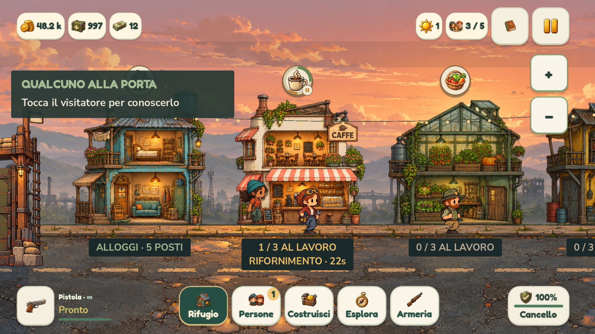
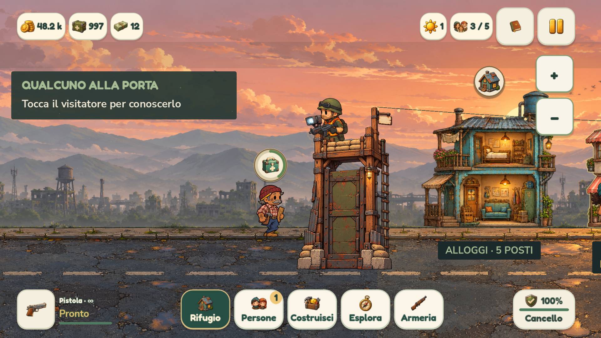

# Preparazioni visibili in città — 0.4.1.47

Durante un rifornimento l'insegna illustrata del negozio mostra un **cerchio che si riempie in senso orario**, con un piccolo orologio. Più prodotti preparati insieme hanno segmenti distinti: ciascuno segue il proprio tempo. Anche il raccolto dell'orto e i materiali dell'officina mostrano l'attività in corso.

I segmenti sono verdi mentre i lavoratori possono procedere. Se mancano le persone necessarie, il segmento diventa oro e compare una piccola pausa; gli altri prodotti continuano se hanno abbastanza lavoratori. La pausa generale congela tutti i timer. Quando una preparazione termina, il suo indicatore scompare; la merce pronta rimane accessibile attraverso i comandi esistenti.

Durante il **controllo del contagio** compare un kit medico sopra il sopravvissuto, circondato dallo stesso avanzamento. Sostituisce la scritta MI RIPOSO e segue la persona e lo scorrimento della visuale. Viene disegnato davanti alla torre, senza intercettare il tocco sul personaggio. Scompare a controllo concluso o quando la persona rifiutata parte, senza anticipare l'esito.

L'avanzamento usa la durata effettiva della preparazione, già ridotta dai talenti dei lavoratori: parte da zero, senza risultare subito parzialmente pieno. Lo stesso valore corregge la barra nella scheda del negozio. Un campo opzionale conserva la durata originale al salvataggio; i salvataggi precedenti restano validi e mantengono il riferimento alla durata base per i lotti già avviati. Il controllo contagio condivide il calcolo della scheda, compresi i tempi da 60/30 secondi e le scoperte ottenute durante l'attesa.

Le insegne mantengono posizione e area cliccabile originali, con le protezioni dagli elementi dell'HUD. I bordi sono disegnati con antialiasing; il kit medico riusa l'illustrazione filtrata già presente nel gioco.

## Verifiche

Sul sorgente passano **93 controlli dedicati senza renderer** e **133 con OpenGL**, comprese 16 acquisizioni su smartphone 16:9 e 20:9, tablet e PC, con zoom minimo e massimo. Il collaudo usa azioni e timer reali: avvio con lavoratori esperti, tre prodotti contemporanei, personale assente, pausa, accelerazione e scaffali automatici, contributi, salvataggio e ripristino, dati precedenti e durata non valida, osservazione normale e medica, scoperta durante l'attesa e rifiuto. Controlla anche i colori realmente disegnati e i clic su insegne e persone. Il solo audio ambientale è escluso dal collaudo grafico; le risorse audio effettive sono verificate dal test del pacchetto.

Passano inoltre **6.309 controlli delle interfacce**, **144 gameplay cozy**, **200 osservazione** e **90 tutorial**. Nessun fallimento. I profili Android sono simulati su computer: non è stata eseguita una nuova prova su dispositivo fisico.

Sul pacchetto Windows esportato passano **133 controlli dedicati con OpenGL**, **6.361 interfacce con OpenGL** e **100 risorse incorporate**; sull'APK **58 controlli**, compreso il nuovo modulo compilato. Nessun fallimento.

Rilascio **0.4.1.47 / Android 401047** completo in `builds/releases/0.4.1.47/`, con setup Windows e APK. Verificati SHA-256 dei tre artefatti, metadati, allineamento e firma Android v2/v3 stabile. Eseguibile dei collegamenti aggiornato, con backup in `.runtime/NienteZombie-prima-indicatori.exe`. Log nella cartella `logs/` del rilascio.

Anteprime dal pacchetto Windows con profilo smartphone 16:9:

