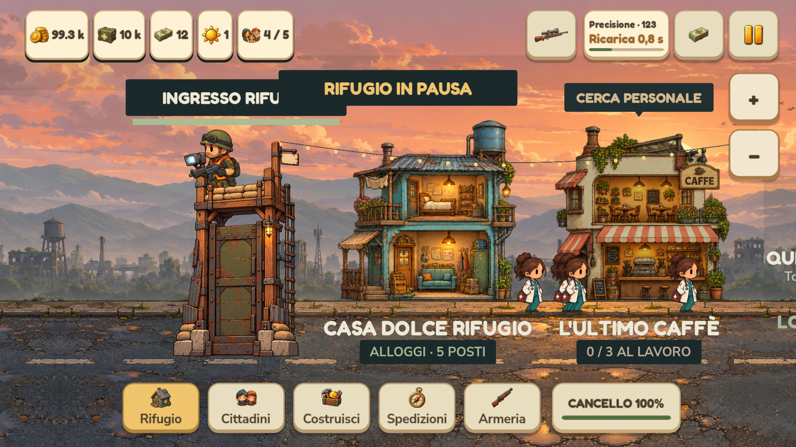
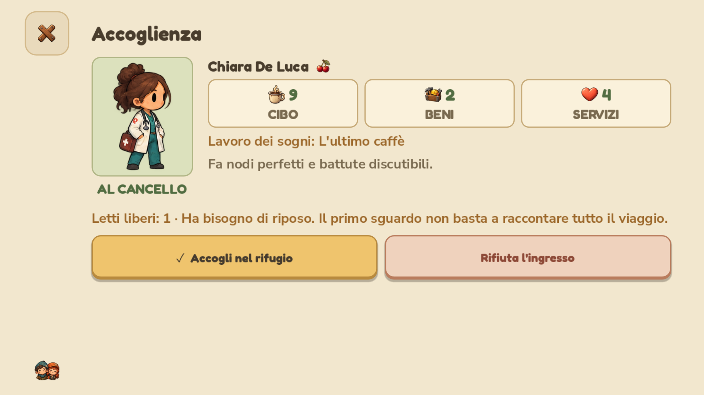
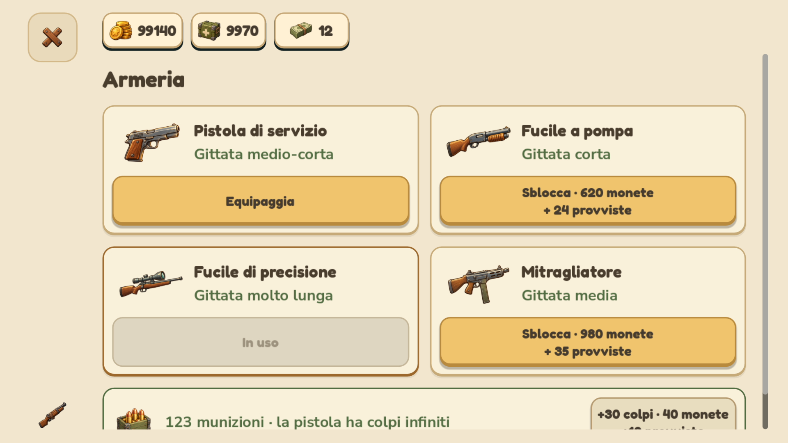

# Attività Notion — 0.4.1.30

Fonte: [board del progetto](https://www.notion.so/2c3be3e6a6bb4eaf8dafb67be01cf219). Le quattro attività in Da fare sono state implementate; la creazione del repository è necessaria per il commit e push richiesti nella stessa sessione.

Repository privato del progetto: [carellice/niente-zombie-per-favore](https://github.com/carellice/niente-zombie-per-favore). La distribuzione conserva gli installer locali in `builds/releases/`; cache, eseguibili generati, dati di esecuzione e chiavi di firma non sono versionati.

## Arma nella barra superiore

Il gruppo con illustrazione, arma attiva, munizioni, ricarica e avanzamento è nella barra superiore fra i contatori e diario/pausa. È sempre visibile nel villaggio e sulla strada. Il pulsante dell'arma apre l'armeria. La composizione si compatta nei formati stretti e alle scale maggiori; su desktop le scorciatoie aggiuntive audio/guida rimangono nella barra solo quando c'è spazio e restano disponibili dalla pausa.

## Passeggiate nel villaggio

I cittadini senza incarico scelgono mete indipendenti, raggiungono la posizione con passi continui, fanno soste e ripartono anche nella direzione opposta. La faccia e l'animazione seguono il verso di marcia e la distanza effettiva. Nessuna ricomparsa all'altro bordo. Lavoratori e cittadini in spedizione mantengono le loro regole; la pausa ferma spostamento e gambe. Il generatore delle passeggiate è separato da quello di combattimento, nomi ed esiti delle spedizioni.

## Risorse nei menu di spesa

Costruzioni, negozi, gestione lavoratori, cittadini/cure, equipaggiamento, armeria, dettagli arma, cancello e spedizioni condividono un piccolo riepilogo fisso di monete, provviste e banconote. Gli importi sono interi esatti, senza abbreviazioni, e si aggiornano dopo le transazioni. Sui telefoni questa è una riga compatta fuori dallo scroll; titolo e azioni continuano a scorrere. Non viene ripristinata la precedente app bar ingombrante.

## Chiara

L'identità dell'infermiera è lo sprite 3 e l'alias storico 7. Il nome è sempre Chiara; i cognomi vengono scelti nel catalogo e restano distinti. I salvataggi correggono il solo nome mantenendo il cognome, salvo collisioni fra identità. Anche dopo l'esaurimento dei cognomi il primo nome rimane Chiara. La ciliegia dipinta compare accanto al nome nell'accoglienza, nelle schede cittadino, nell'equipaggiamento e nella preparazione delle spedizioni. Aspetto e indizi di contagio non cambiano.

## Verifiche

Il test `test_board_oct24.gd` copre le quattro richieste con 789 controlli su quattro profili e tre scale UI. La regressione copre anche 2.621 controlli di layout, 880 UX, 354 scroll touch, 85 interazioni, 751 di simulazione, 655 economia/combattimento, 54 integrazione della camminata e 30 sulla varietà dei sopravvissuti. I test girano con salvataggi isolati; quelli grafici usano il renderer OpenGL del computer, non un dispositivo Pixel fisico. Risultati dei pacchetti in `VERIFICHE_MOBILE.md`.

Anche il pacchetto Windows passa 789 controlli della board, 2.621 di layout, 85 interazioni, 880 UX e 87 risorse. L'APK firmato passa 39 controlli delle risorse. Versione comune 0.4.1.30, codice Android 401030.

