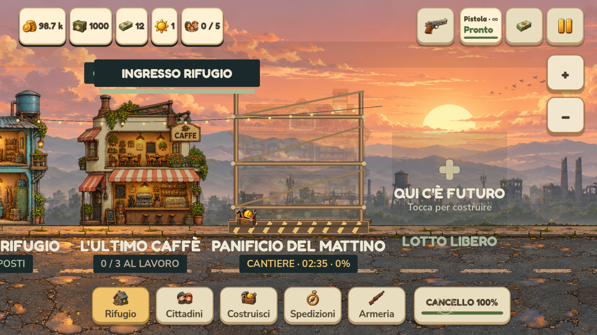
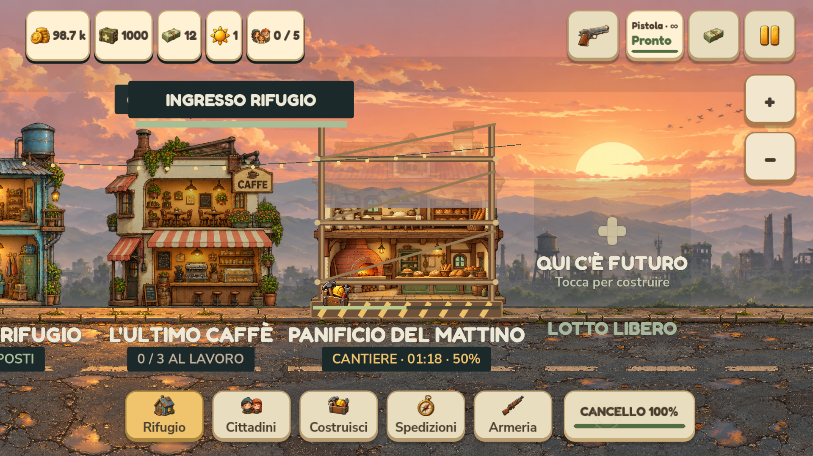

# Cantieri e attese progressive — 0.4.1.33

Ogni nuovo edificio parte come cantiere: l'illustrazione emerge gradualmente dietro ponteggi in legno, una barriera, attrezzi animati e nuvole di polvere. Il lotto mostra conto alla rovescia e avanzamento. Il suo dialogo distingue fondamenta, struttura e finiture; si aggiorna automaticamente alla scheda dell'edificio operativo quando i lavori sono terminati. Una breve animazione e una notifica segnalano il completamento.

## Durate

Il menu Costruisci mostra il costo in monete e il tempo prima dell'acquisto. Il prezzo viene addebitato una volta all'avvio, senza ulteriori costi alla fine.

| Tipo | Tempo base, rifugio vuoto |
| --- | ---: |
| Casa | 30 s |
| Caffè | 45 s |
| Orto | 60 s |
| Officina | 90 s |
| Clinica | 120 s |
| Panificio | 90 s |
| Depuratore | 135 s |
| Sartoria | 105 s |

Per `n` lotti già avviati il tempo è il valore base moltiplicato per `1 + 0,28n + 0,04n²`, arrotondato al secondo superiore. Contano anche i cantieri in corso. Il preventivo rimane fisso dopo la partenza; non si allunga durante il lavoro. Il limite massimo è sei ore. Ad esempio, una casa richiede 30 secondi nel rifugio vuoto, circa 1:42 con cinque lotti e 3:54 con dieci; una clinica con dieci lotti richiede circa 15:36.

Si possono avere più cantieri regolari contemporaneamente, ciascuno con il proprio timer. Nel tutorial si attende il completamento del primo cantiere prima del successivo, per proteggere il budget guidato: prima casa 6 secondi, primo caffè 10 secondi. La guida apre il lotto in costruzione e prosegue solo quando letti o negozio sono effettivamente disponibili.

## Disponibilità e salvataggi

- Case e negozi diventano operativi solo a fine lavori. Prima non offrono letti, lavoro, prodotti o ricavi.
- Gli obiettivi del diario contano il completamento, una sola volta per edificio.
- Il timer si ferma durante la pausa della partita e prosegue a gioco chiuso attraverso il sistema offline esistente, anche per chiusure inferiori a venti secondi.
- Su Android la coppia sospensione/ripresa recupera anche il tempo perso senza terminare il processo. Il tempo già simulato da eventuali frame in background viene sottratto per evitare doppi avanzamenti; il rientro non simula combattimento aggiuntivo.
- Durata e tempo residuo sono salvati sul singolo lotto. Il completamento offline attiva l'edificio e viene segnalato al rientro; valgono il tetto offline di otto ore e la protezione dal ritorno indietro dell'orologio già presenti.
- Gli edifici dei salvataggi precedenti restano pronti: non vengono rimessi in costruzione.

## Verifiche

Sorgente: 200 controlli su ciclo del cantiere, costi, progressione, pausa, disponibilità, tutorial, salvataggi, migrazione e completamento offline; 124 controlli UI con renderer OpenGL, tocchi effettivi e quattro profili nelle tre scale dell'interfaccia; 90 sul tutorial completo. Passano anche 2.621 layout, 751 simulazione, 655 economia/combattimento, 880 UX, 354 scroll touch e 54 camminata. Le fixture degli altri test preparano edifici già operativi usando il normale completamento, senza avanzare incidentalmente il combattimento; i nuovi test esercitano direttamente i timer reali.

Le prove grafiche e touch sono effettuate sul computer, non su Pixel fisico. I risultati dei pacchetti sono riportati in [VERIFICHE_MOBILE.md](VERIFICHE_MOBILE.md).

Sul pacchetto Windows finale sono passati 200 controlli del modello, 124 dell'interfaccia con renderer OpenGL, 90 del tutorial, 880 UX e 87 delle risorse. L'APK passa 41 controlli, inclusi i due nuovi moduli di costruzione. Versione comune 0.4.1.33, codice Android 401033; firma, allineamento e checksum verificati.

