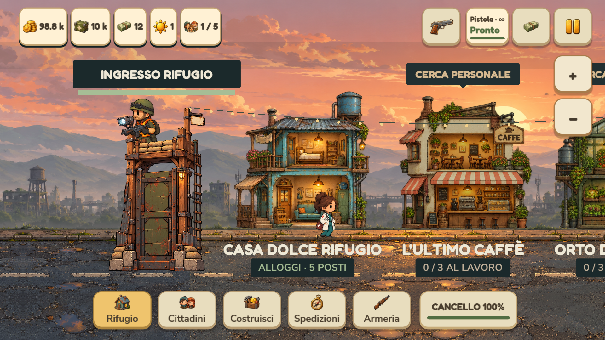
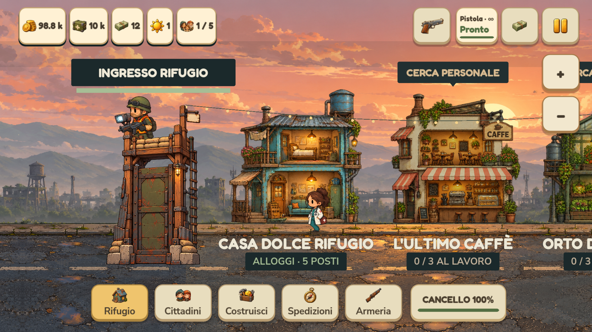
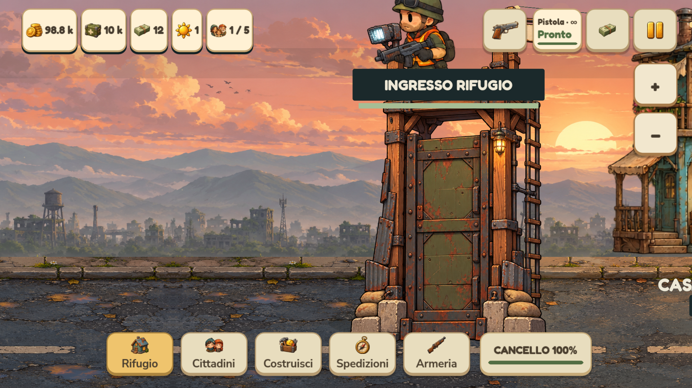

# Cittadini, inversioni e stato del cancello — 0.4.1.31

## Correzioni

Il verso di marcia del cittadino veniva passato per errore al parametro che seleziona il rendering zombie. Quando un abitante camminava a sinistra poteva quindi apparire con il corpo di uno zombie e mantenere l'orientamento sbagliato. Ora il verso viene passato al parametro di specchiatura, mentre il parametro zombie rimane esplicitamente falso per i cittadini. Non venivano rimossi abitanti dal salvataggio: il problema era nella presentazione.

La correzione conserva identità, aspetto pulito/sporco, varianti, alias storici, fase alternata delle gambe e pose di lavoro. Le passeggiate casuali continuano a usare il loro generatore indipendente. Gli abitanti in pausa, al lavoro o fuori in spedizione conservano le rispettive regole.

La scritta **Ingresso rifugio** e la sua barra sono ancorate alla posizione sullo schermo acquisita all'apertura della partita. Zoom, spostamento della telecamera e scosse non ricalcolano l'ancoraggio. Cambi di risoluzione, area sicura e dimensione dell'interfaccia adattano nuovamente i margini. La barra si aggiorna con la salute effettiva del cancello. Lo stato viene disegnato dopo torre, militare e resto della scena, così non viene coperto dagli sprite. La visuale resta esclusivamente orizzontale.

## Superstiti sporchi

Lo sporco è un elemento cosmetico che crea dubbio: una persona solo sporca è sana e viene accolta normalmente, senza danni al cancello. Mantiene l'aspetto sporco anche dopo l'ingresso; non è previsto un sistema di lavaggio. Gli infiltrati usano una variante con segni di possibile contagio. Accoglierne uno causa 36 punti di danno al cancello e genera una minaccia da eliminare; non entra come cittadino e non contagia gli altri abitanti. Questa logica non cambia con la correzione del rendering.

## Verifiche

Il nuovo test osserva le chiamate effettive al renderer, oltre ai timer di movimento: 16 ID, comprese le quattro alias storiche, tre condizioni visive e due direzioni, su quattro profili di display. Verifica anche un'inversione scelta dal normale algoritmo delle passeggiate, la continuità della fase delle gambe, la posa di lavoro, l'ancoraggio dello stato del cancello alle tre scale UI e l'ordine di disegno.

Sul sorgente sono passati 1.728 controlli con renderer OpenGL, 2.621 di layout telefono/PC/tablet e 54 d'integrazione della camminata. I test usano dati isolati. Le prove grafiche sono eseguite sul computer, non su un Pixel fisico. Risultati dei pacchetti in [VERIFICHE_MOBILE.md](VERIFICHE_MOBILE.md).

Sul codice incorporato nell'eseguibile Windows sono passati 1.732 controlli di rendering, 85 interazioni e 87 verifiche delle risorse. I quattro controlli aggiuntivi salvano le viste del cancello prima dello zoom. L'APK firmato supera 39 controlli delle risorse; firma, versione, allineamento e checksum verificati. Versione comune 0.4.1.31, codice Android 401031.

