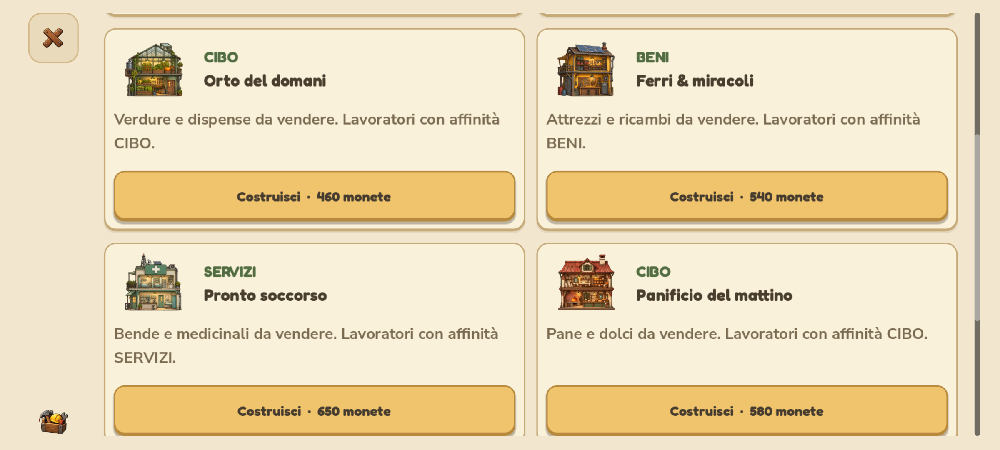
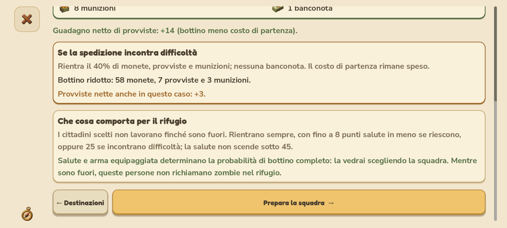

# Costruzioni, spedizioni e popolazione — 0.4.1.29

## Costruisci

Otto schede con la stessa struttura: illustrazione dell'edificio, categoria, nome, funzione e pulsante a tutta larghezza in fondo. Non viene più usata una riga che può ripiegare soltanto il pulsante del panificio. La griglia si adatta al formato e alla dimensione dell'interfaccia; il prezzo viene dal modello e il comando è disabilitato se mancano monete. Il tutorial conserva le sue restrizioni.

## Spedizioni

Tre pagine distinte, con selezioni conservate quando si torna indietro:

1. **Destinazione**: nove percorsi con tempo, difficoltà, costo e sintesi del bottino.
2. **Dettagli**: costo pagato soltanto alla partenza, bottino completo con icone, guadagno netto di provviste, bottino ridotto e conseguenze sul rifugio.
3. **Squadra**: da uno a tre cittadini con ritratto, salute, incarico, arma e potenza. La probabilità di bottino completo viene calcolata dalla stessa funzione usata alla partenza. Il comando indica le provviste richieste e spiega perché non si può partire.

La spedizione sospende il lavoro dei partecipanti. Un esito difficile assegna il 40% intero di monete, provviste e munizioni, senza banconote. Tutti tornano: perdono 8 punti salute in caso di successo e 25 in caso di difficoltà, con limite inferiore a 45. Il ritiro è gratuito. Le pagine in corso e di ritorno distinguono risorse possibili da risorse effettivamente ottenute; l'esito non viene anticipato mentre la squadra è fuori. Non cambiano costi e ricompense delle nove zone.

Su smartphone titolo e azioni scorrono nel contenuto con padding reale ai due lati. PC e tablet mantengono le azioni principali fuori dallo scorrimento.

## Pressione degli zombie

Conta soltanto chi è fisicamente nel rifugio: nessun superstite in attesa, nessun membro temporaneamente in spedizione, nessun conteggio del militare permanente.

| Persone presenti | Zombie per gruppo | Pausa dopo la vittoria |
| ---: | ---: | ---: |
| 0 | 2–8 | 55–95 s |
| 5 | 3–11 | circa 49–84 s |
| 20 | 5–16 | circa 39–67 s |
| 60 | 7–20 | circa 31–54 s |

La curva è `p / (p + 20)`, con limiti fissi: al massimo 8–24 zombie per gruppo e una pausa che tende a 23–40 secondi. Anche gli ingressi del singolo gruppo diventano leggermente più ravvicinati. Composizioni e intervalli restano casuali; il numero storico dei gruppi non fa crescere la difficoltà. Un gruppo ancora attivo impedisce l'arrivo del successivo.

Se la popolazione cambia durante la pausa, il tempo residuo si adatta preservando il progresso già trascorso. La scala viene salvata per evitare un secondo accorciamento al caricamento; i vecchi salvataggi vengono adattati una volta. Il tutorial rimane protetto. La guida nel gioco spiega il legame con la popolazione.

## Verifiche

Sorgente: 1.044 controlli dedicati a popolazione, timer persistenti, anteprime, costi e risultati delle spedizioni; 751 di simulazione con sessione di due ore; 655 su combattimento/economia/contenuti; 880 UX; 354 scroll touch e 85 interazioni smartphone. Nessun fallimento. Anteprime e ulteriori verifiche dei pacchetti sono riepilogate in `VERIFICHE_MOBILE.md`. Le prove con display e tocchi sono simulate sul computer, non effettuate su un Pixel fisico.

Il pacchetto Windows supera anche 2.621 controlli di layout, 85 interazioni, 880 UX, 1.044 del modello e 87 risorse; l'APK supera 37 controlli delle risorse. Firma, versione, allineamento e checksum verificati. Il rilascio è disponibile in `builds/releases/0.4.1.29/`.

