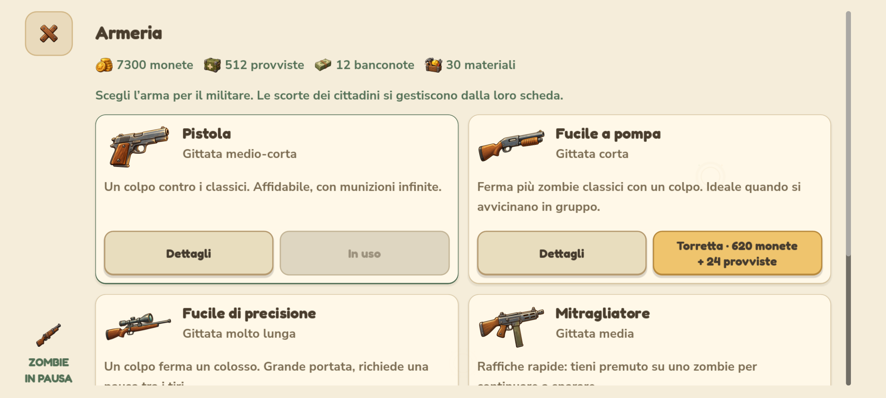
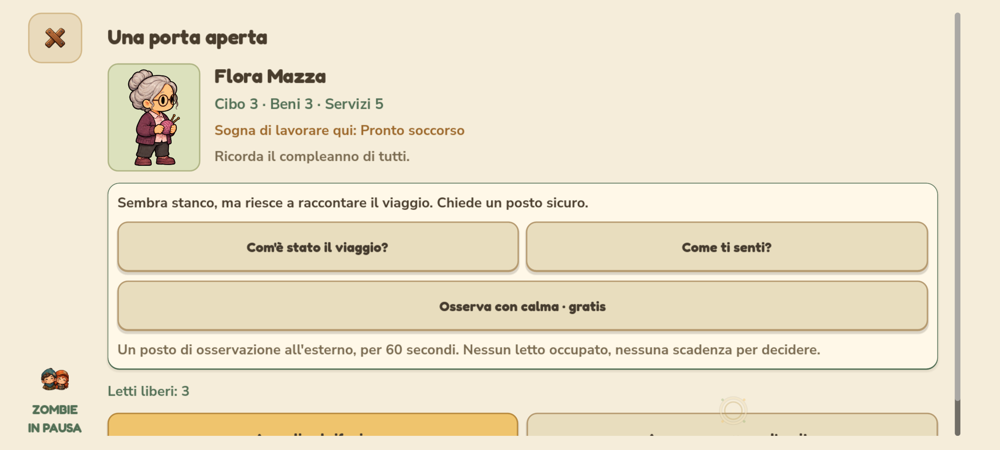
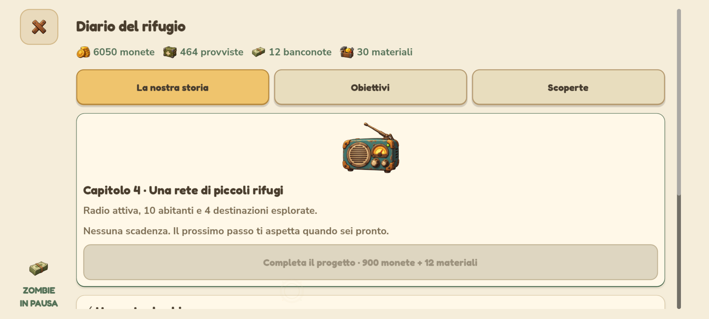

# Un rifugio da vivere con calma — 0.4.1.40

Revisione dei sette punti concordati, con orientamento cozy e interfacce pensate prima di tutto per lo smartphone. Il mondo conserva la vista orizzontale, gli sprite ingranditi sui telefoni, l'identità illustrata, le camminate e la demolizione con pressione prolungata.

## Ritmo e decisioni

- Gruppi iniziali di 2–5 zombie e pause di 90–150 secondi dopo aver respinto il gruppo. La popolazione presente aumenta gradualmente la pressione, fino a un limite teorico di 5–11 zombie e 63–105 secondi; le varianti e il sistema che evita tre gruppi consecutivi solo classici restano attivi. Un caffè con lavoratore presente allunga la pausa del 20%, una sola volta.
- Mentre un dialogo è aperto, zombie e attesa del prossimo gruppo si fermano; produzioni, osservazioni e viaggi proseguono. Pausa, impostazioni e menu principale fermano tutta la simulazione.
- Una breccia usa il 3% delle monete con tetto di 50, più al massimo 2 provviste. Cittadini, edifici e progressi rimangono al sicuro. Il cancello viene ripristinato come prima.
- Gli abitanti presenti aggiungono l'1,5% ai ricavi delle vendite a persona, fino al 30%. Le ricompense della difesa sono ridotte a 6 monete per zombie, 18 per colosso e 20–40 alla fine del gruppo. Una provvista soltanto dai colossi: le attività e le spedizioni sostengono l'economia.
- I nuovi cantieri mantengono tempi progressivi, con curva più dolce e tetto di 30 minuti. I cantieri già pagati nei vecchi salvataggi conservano il proprio timer, fino al precedente limite di sei ore.

La pistola mantiene danno 68 e colpi infiniti. Il pompa infligge 110 al bersaglio e 77 ai vicini; la precisione 230, sufficienti a fermare un colosso anche da vicino; il mitragliatore 44, sufficienti contro un corridore. Portate, consumo di un colpo per tiro e cadenze rimangono distinti. Il militare continua a sparare solo al comando del giocatore.

## Edifici con un contributo diverso

I bonus richiedono almeno un lavoratore presente e un edificio completato. Più copie dello stesso servizio non sommano il bonus passivo.

| Edificio | Contributo oltre alle vendite |
| --- | --- |
| Casa | Cinque letti per livello |
| Caffè | Pausa fra gli attacchi +20% |
| Orto | Raccolto di 12 provviste, 20 monete e 120 secondi; 18 provviste dopo la scoperta dei semi |
| Officina | Tre materiali, 35 monete e 150 secondi; due materiali possono riparare completamente il cancello |
| Clinica | Cure a due provviste e danni di rientro dalle spedizioni dimezzati |
| Panificio | Bottino di monete e provviste +15%, poi +25% con le ricette da viaggio |
| Depuratore | Costo di partenza delle spedizioni ridotto del 25%, arrotondato per eccesso |
| Sartoria | Probabilità di bottino completo +10 punti percentuali, poi +15 con la mappa dei segnali |

Orto e officina hanno preparazione e ritiro espliciti. Il tempo richiede un lavoratore; un contributo pronto si può ritirare anche dopo aver liberato la squadra. I materiali vengono salvati, mostrati nei saldi e spesi solo da azioni esplicite. Demolire elimina anche il contributo in preparazione o pronto, indicato nella conferma.

## Spedizioni e accoglienza

Ogni destinazione assegna materiali oltre al bottino esistente. Al primo rientro ritirato, anche con esito difficile, si trova sempre un progetto distinto. I nove progetti sbloccano magazzini, scaffali automatici, osservazione più breve, raccolti migliori, cure meno costose, bonus di viaggio e radio. Il diario spiega effetto e luogo di ogni scoperta. Le risorse non si riscuotono due volte. Le zone già esplorate nei vecchi salvataggi riconoscono la scoperta corrispondente senza assegnare altro bottino.

Il rientro resta garantito, con perdita base di 4 salute per bottino completo o 14 per un viaggio difficile, e minimo salute 45. L'eventuale sconto della clinica viene fissato alla partenza: un cambio dei lavoratori durante il viaggio non peggiora la previsione mostrata. Le armi personali e i loro consumi rimangono separati dalla torretta.

All'accoglienza si possono fare due domande, con risposte persistenti, e usare gratuitamente un posto di osservazione esterno. Dura 60 secondi, 30 dopo la scoperta al laboratorio. Nessun letto viene occupato. Durante l'osservazione l'ingresso attende l'esito; dopo, il rapporto distingue con certezza una persona sana da un contagio confermato. Un caso confermato non può entrare. Resta possibile prendere una decisione immediata senza osservazione, con le conseguenze degli infiltrati già esistenti. Nessuna scadenza per accogliere o rifiutare.

## Storia e gestione del villaggio

Il diario ha tre sezioni: **La nostra storia**, **Obiettivi**, **Scoperte**. Quattro capitoli consecutivi accompagnano casa e primi abitanti, dispensa, radio e rete di rifugi. I requisiti e gli eventuali costi si leggono prima di confermare. I capitoli completati conservano il ricordo narrativo. La radio compare sulla torre dopo il suo progetto.

La rete sblocca scambi ripetibili con i vicini: una consegna per giorno di gioco, senza scadenza e con costo e ricompense espliciti. La partita continua liberamente anche dopo i capitoli. I 32 obiettivi precedenti e le ricompense già riscosse rimangono acquisiti.

**Avvia tutti** paga solo il totale mostrato delle produzioni vuote sbloccate; se mancano risorse non parte nessuna produzione. **Esponi tutta la merce pronta** non costa nulla. Questi comandi sono nella bottega e, da tre edifici, nel catalogo per l'intero villaggio. Il lotto resta libero per l'espansione.

Con i progetti trovati in spedizione si possono comprare un magazzino doppio (350 monete e quattro materiali) e scaffali automatici (500 monete e sei materiali) per ogni attività. Il magazzino si somma al lavoro ideale; gli scaffali espongono le preparazioni concluse e non avviano mai spese automatiche. Ogni miglioria si paga una sola volta. Una produzione in blocco emette un solo riscontro e salva una sola volta.

## Interfacce

Nuova base di carta chiara, contorni morbidi, ombre leggere, salvia e miele. Schede espandibili a tutta la colonna e azioni allineate. Le illustrazioni esistenti restano in uso.

- Botteghe divise in Bottega, Contributo e Migliorie; si riaprono sulla produzione. Le sezioni cambiano tornando in cima, le azioni nella stessa sezione conservano lo scorrimento.
- Armeria, costruzioni, cittadini ed equipaggiamento personale in griglie adattive, senza lunghi dossier ripetuti. Le armi hanno immagini, ruolo, dettagli e azione distinta.
- Spedizioni con scoperta in evidenza, materiali fra le ricompense e tre passi di preparazione già esistenti.
- Accoglienza con ritratto coerente, valori interi, domande, rapporto e due decisioni separate.
- Pausa ricomposta con ripresa principale, impostazioni/aiuto e salvataggio/uscita distinti; menu principale più luminoso. Impostazioni, aiuto, crediti, difese, costruzione e demolizione condividono il nuovo stile.
- Sugli smartphone le pagine riempiono il display, con un solo scorrimento verticale, controllo laterale, margini simmetrici e area sicura. Titolo e saldi scorrono con il contenuto; non ci sono app bar o footer fissi. Il controllo laterale segnala la pausa degli zombie. Le tre scale dell'interfaccia rimangono selezionabili.

## Compatibilità e verifiche

Formato del salvataggio invariato (versione 2). I nuovi campi sono opzionali per i salvataggi precedenti; dati della comunità, materiali, ricette, miglioramenti, osservazioni e timer sono persistenti. Ripresa Android e caricamento recuperano il tempo perso dai nuovi timer senza contare due volte i frame già simulati. Le prove usano dati isolati dalla partita del giocatore.

I risultati effettivi dei test e dei pacchetti sono riportati in fondo dopo la verifica del rilascio. Il bilanciamento proposto è una prima taratura cozy; i tempi percepiti e il comfort sul Pixel richiedono una prova del giocatore sul dispositivo fisico.

| Verifica sul sorgente | Controlli | Fallimenti |
| --- | ---: | ---: |
| Gameplay cozy, servizi, scoperte, osservazione, progetti, scambi, salvataggi e ripresa | 144 | 0 |
| Interfacce con OpenGL e input effettivo: quattro profili, tre scale UI | 2.924 | 0 |
| Demolizione | 138 | 0 |
| Costruzione e persistenza | 200 | 0 |
| Equipaggiamento personale | 563 | 0 |
| Popolazione e spedizioni | 1.045 | 0 |
| Tutorial completo | 90 | 0 |
| Simulazione e salvataggi, due ore | 751 | 0 |
| Scorrimento touch | 372 | 0 |
| Tiro effettivo e raffica | 25 | 0 |
| Interazioni smartphone | 85 | 0 |

Sul pacchetto Windows esportato passano **144 controlli del gameplay**, **2.924 dell'interfaccia** e **90 delle risorse**, compresa la radio con mipmap. L'APK supera **48 controlli**, compresi i nuovi moduli e la texture della radio. Nessun fallimento. Il test dell'APK legge i file confezionati; i profili Android di interfaccia e input sono simulati sul computer, non eseguiti su un Pixel fisico.

I test precedenti sono stati adeguati ai cambiamenti deliberati: gruppi più piccoli e distanziati, danno del mitragliatore, salute di rientro, materiali nel bottino e limite dei nuovi cantieri. Restano verificati carichi duplicati, risorse insufficienti, tutorial, migrazione e timer invalidi. Cinque avvisi sui salvataggi incompleti sono attesi nel test della costruzione.

Rilascio **0.4.1.40 / Android 401040** completo in `builds/releases/0.4.1.40/`: setup Windows, eseguibile e APK firmato. Verificati SHA-256 dei tre artefatti, metadati, allineamento e firma v2/v3 con certificato stabile. Eseguibile dei collegamenti aggiornato; copia precedente in `.runtime/NienteZombie-prima-cozy.exe`. Log nel rilascio.

Anteprime reali del pacchetto esportato:

## Asset della radio

Generata con lo strumento integrato imagegen, trasparenza originale preservata, file finale `assets/art/community-radio.png`; importazione con mipmap. Usata nel diario e sulla torre. Prompt integrale:

> Use case: stylized-concept. Asset type: transparent 2D game sprite and menu illustration for an existing cozy Italian post-apocalyptic village management game. Primary request: one charming salvaged tabletop radio transceiver, front view with a little view of its right side, a short angled antenna, rounded teal metal shell with warm ochre corners, cream circular speaker, amber glowing tuning dial, two chunky knobs, a small friendly green status lamp. Hand-painted cartoon storybook game art, dark brown soft outlines, rounded toy-like proportions, subtle weathered paint, warm evening light. Isolated single object centered with generous padding, genuine transparent background, no floor, no scenery, no surrounding glow outside the silhouette. No lettering, no words, no logos, no watermark. Clear readable silhouette at small size. Keep all parts of the radio and antenna inside the image.
