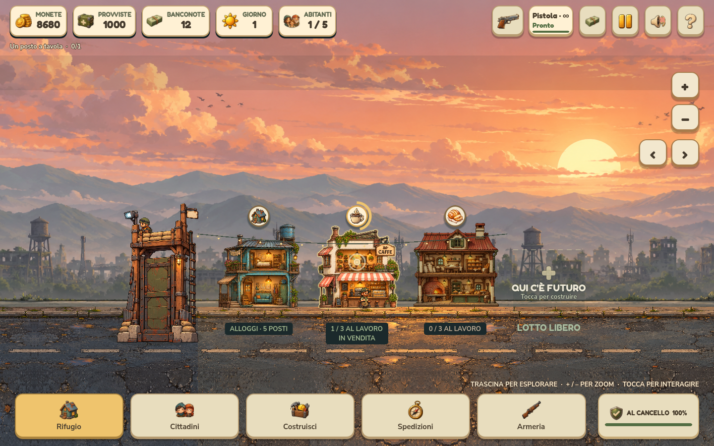
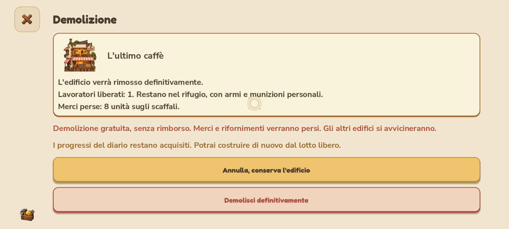

# Demolizione con pressione prolungata — 0.4.1.39

Tieni premuto per circa **0,65 secondi** su un edificio o sulla sua insegna: un anello mostra l'avanzamento del gesto, poi compare il riepilogo di demolizione. Il rilascio della pressione originale non conferma nulla. Per eliminare l'edificio serve un nuovo tocco su **Demolisci definitivamente**; **Annulla** conserva tutto. Il tocco breve continua ad aprire la normale scheda.

Trascinamento, secondo dito, zoom, tocco annullato, perdita di focus e apertura di un altro menu interrompono il gesto. Anche il rilascio assorbito dall'HUD termina correttamente la pressione sulla scena. Il comportamento è disponibile con mouse e con il touch Android emulato dal progetto. Un suggerimento è presente nelle schede degli edifici e nel manuale.

## Effetti

- Demolizione gratuita e **nessun rimborso**. Si perdono edificio, merci sugli scaffali, produzioni pronte e rifornimenti in corso; il riepilogo mostra le quantità interessate.
- Anche un cantiere può essere annullato: il costo pagato e il tempo trascorso non vengono recuperati e quel cantiere non completerà più la costruzione.
- I lavoratori vengono liberati dall'assegnazione, compresi quelli fuori in spedizione. Cittadini, armi e munizioni personali restano nel rifugio; il viaggio già in corso prosegue e al ritorno non viene ripristinato un lavoro inesistente.
- Una casa pronta si può rimuovere solo se gli altri alloggi completati ospitano tutti i cittadini, compresi quelli assenti. Una casa ancora in costruzione non vale come alloggio sostitutivo.
- Durante il tutorial bisogna prima completare o saltare la guida, per non perdere gli edifici necessari ai passaggi iniziali.
- Il villaggio si ricompatta, i limiti della telecamera si aggiornano e Costruisci mostra il nuovo numero di edifici presenti.

I progressi e i premi del diario rimangono acquisiti. I tempi delle costruzioni successive mantengono la progressione dei cantieri avviati, anche dopo le demolizioni; i prezzi continuano a dipendere dalle copie attualmente presenti del tipo scelto. Lo storico delle costruzioni è salvato nelle statistiche. I salvataggi precedenti, senza questo dato, partono dai lotti esistenti; il formato rimane compatibile con la versione 2.

## Verifiche del sorgente

| Verifica | Controlli | Fallimenti |
| --- | ---: | ---: |
| Demolizione di tutti gli otto tipi, scorte, lavoratori in viaggio, case, cantieri, salvataggi e progressione | 138 | 0 |
| Input reale, conferma/annullamento e interruzioni del gesto, quattro profili e tre scale UI con OpenGL | 236 | 0 |
| Ciclo di costruzione e ripresa | 200 | 0 |
| Interazioni smartphone | 85 | 0 |
| Tiro, portata e mitragliatore | 25 | 0 |
| Simulazione prolungata e salvataggi | 751 | 0 |
| Estensione del villaggio, senza acquisizioni | 596 | 0 |
| Tutorial completo | 90 | 0 |
| Scroll touch | 354 | 0 |

I test usano dati isolati dalla partita del giocatore. I profili Android e le interruzioni del gesto sono simulati sul computer; non costituiscono un nuovo collaudo su Pixel fisico.

## Pacchetti verificati

Il pacchetto Windows esportato supera gli stessi **138 controlli del modello**, **236 dell'interfaccia con OpenGL** e **87 delle risorse**, senza fallimenti. L'APK supera **45 controlli**, compresa la presenza del nuovo modulo di demolizione. Le prove Windows partono dalla cartella del rilascio e caricano le risorse incorporate.

Setup Windows e APK **0.4.1.39 / Android 401039** generati in `builds/releases/0.4.1.39/`. Verificati metadati, allineamento, firma Android v2/v3 con certificato stabile e SHA-256 dei tre artefatti. Eseguibile dei collegamenti aggiornato; precedente conservato in `.runtime/NienteZombie-prima-demolizione.exe`. Log nel rilascio.

Anteprime dal pacchetto Windows: pressione in corso e riepilogo smartphone, con contenuto scorrevole e conferma esplicita.

