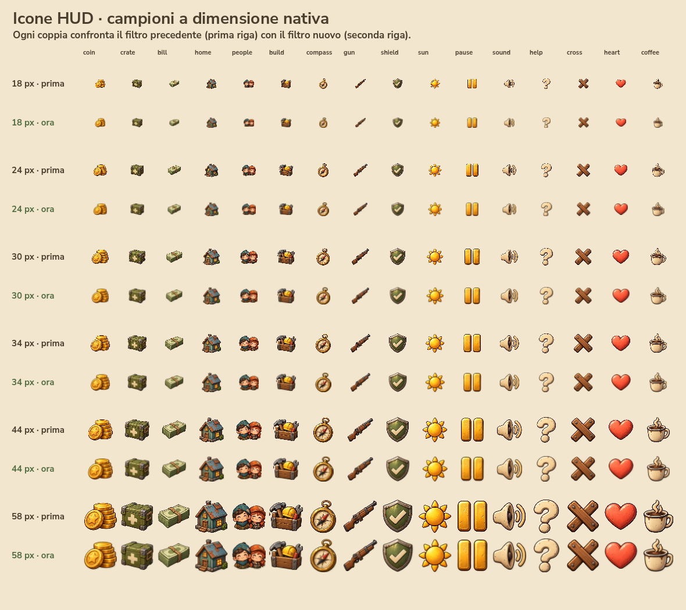
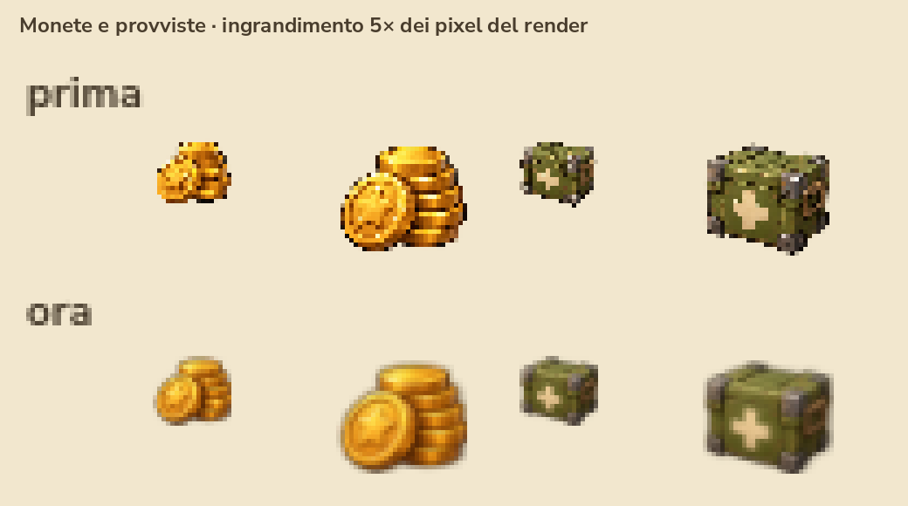

# Icone HUD: bordi uniformi alle piccole dimensioni

Le icone dipinte vengono ritagliate dall'atlante e memorizzate una sola volta come texture separate con mipmap. Il filtro trilineare sceglie e interpola i livelli adatti alle dimensioni effettive dello schermo. Il ritaglio precede la generazione delle mipmap, quindi le icone vicine nell'atlante non possono mescolare i loro colori ai bordi.

Le immagini originali restano alla risoluzione iniziale. La soluzione funziona anche quando il ridimensionamento della finestra produce dimensioni o posizioni frazionarie, senza richiedere file PNG per ciascuna dimensione dell'HUD.

## Verifica del render nativo

`tests/render_icon_filter_comparison.gd` usa i `Glyph` reali dell'interfaccia per la versione corretta e riproduce separatamente il vecchio disegno dall'atlante con filtro lineare. Il confronto comprende tutti i 16 simboli a 18, 24, 30, 34, 44 e 58 pixel.

L'ingrandimento seguente usa il filtro nearest sul render già acquisito: mostra i pixel effettivi, senza aggiungere un ulteriore filtro di sfocatura.

La misura numerica verifica monete e provviste alle sei dimensioni e a tre posizioni frazionarie (0, 0,25 e 0,5 pixel): 36 casi. Il riferimento è un render 8× del disegno originale, integrato per area. Su GPU NVIDIA RTX 5050, OpenGL Compatibility Godot 4.5.1, la distanza media dei pixel dal riferimento passa da 0,17767820 a 0,11594684: una riduzione del **34,74%**. È una misura della qualità del ricampionamento; il confronto visivo conferma bordi uniformi e assenza di colori provenienti dai simboli vicini.

Il test controlla anche che tutte le 16 texture abbiano mipmap, conservino i propri limiti originali, rimangano separate dalle altre e vengano riutilizzate dalla cache. Gli alias condividono la texture corretta; icona del gioco e ritaglio del volto dell'allarme zombie hanno anch'essi mipmap.

Risultato: **77 verifiche, 0 errori**. Log: `tests/icon-filter-comparison-native.log`. I dati e le acquisizioni originali sono in `.runtime/icon-filter-comparison/`.

Gli stessi 77 controlli sono stati ripetuti sull'eseguibile Windows 0.2.5.4 con le risorse impacchettate, ottenendo gli stessi risultati. Log: `tests/icon-filter-packed.log`; acquisizioni in `.runtime/icon-filter-packed/`. Anche l'interazione dell'allarme e il successivo sparo sono stati nuovamente verificati nell'eseguibile: 38 controlli, 0 errori.

Per ripetere la verifica, avviare Godot nativo con `--path . --script tests/render_icon_filter_comparison.gd`, usando `APPDATA` in una cartella di prova sotto `.runtime/`. L'argomento utente `--evidence-folder=C:/percorso/assoluto` permette di scegliere la cartella di acquisizione anche provando l'eseguibile esportato. Il test non scrive salvataggi o preferenze del giocatore.
