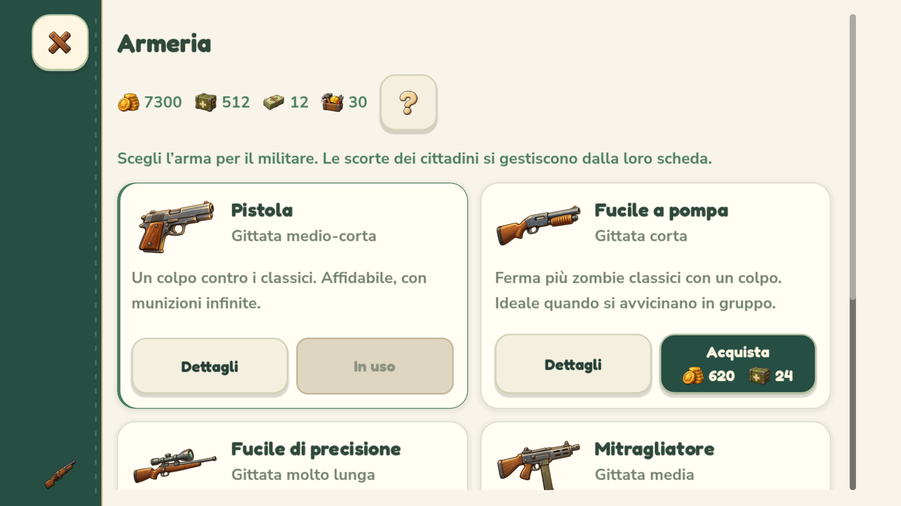
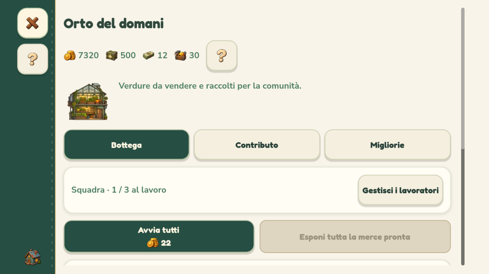

# Meno scritte, più icone — 0.4.1.44

Costi e risorse usano ora **illustrazione e quantità**, con il nome dell'azione separato: Costruisci, Acquista, Avvia rifornimento, Cura, Ripara, Potenzia, Parti o Ritira. I numeri restano interi. Monete, provviste, materiali e banconote conservano le rispettive icone del gioco; durata e munizioni hanno un simbolo dedicato.

La revisione comprende costruzioni, prodotti e rifornimenti multipli, contributi dei negozi, migliorie, armeria della torretta, equipaggiamento e colpi personali, cure, difese, progetti, ricompense del diario e spedizioni. I prezzi e i controlli sulle risorse continuano a provenire dal modello esistente.

## Schermate alleggerite

- Il portafoglio nei dialoghi mostra le quattro icone e i saldi. Il **?** apre e richiude una legenda nella stessa schermata, senza perdere scelte o navigazione.
- I costi hanno un gruppo centrato che va a capo quando lo spazio diminuisce. Le quantità si aggiornano anche quando cambiano danni al cancello, budget o stato di preparazione.
- Nei telefoni sono rimosse l'intestazione ripetuta sopra il titolo e la scritta decorativa nella fascia laterale. La pausa usa sole e persone al posto del riepilogo scritto.
- Il catalogo delle spedizioni distingue bottino e spesa alla partenza. Anche dettaglio, squadra e rientro usano quantità illustrate; costi personali e munizioni della torretta restano distinti. Rimangono espliciti probabilità, conseguenze, rientro garantito e riduzione del bottino.
- I contributi dell'orto e dell'officina mostrano risultato e durata con icone, insieme allo stato effettivo; durante la preparazione e al ritiro non mostrano un nuovo prezzo da pagare.
- I talenti nelle schede dei cittadini e dei visitatori usano gli stessi simboli. La salute mantiene percentuale e indicazione testuale per distinguerla dal talento servizi.

Le istruzioni del tutorial, le spiegazioni nell'aiuto e gli effetti delle decisioni conservano i testi necessari. Nessuna nuova illustrazione o registrazione è stata aggiunta: sono riutilizzate le icone dipinte già incluse nel gioco, con filtro e mipmap esistenti.

## Implementazione e verifiche

`resource_ui.gd` compone le quantità e i contenuti dei pulsanti. Il pulsante originale gestisce ancora input, callback, suono, stato disabilitato e nome accessibile; icone e scritte interne ignorano il mouse. Il testo esteso delle unità rimane nei suggerimenti. I nodi delle quantità vengono riutilizzati negli aggiornamenti periodici.

I test usano salvataggi e preferenze isolati. Le prove Android sono simulate su computer e non sostituiscono una nuova prova su un dispositivo fisico.

| Verifica sul sorgente | Controlli | Fallimenti |
| --- | ---: | ---: |
| Interfaccia OpenGL: PC, smartphone 16:9/20:9 e tablet, tre scale, 52 acquisizioni | 6.343 | 0 |
| Tocchi sulle icone, pagamenti singoli, quantità visibili, legenda e disponibilità | 68 | 0 |
| Affidabilità dei pulsanti della difesa | 192 | 0 |
| Costruzioni, costi, durata e acquisto effettivo, senza acquisizioni | 168 | 0 |
| Tutorial completo attraverso le azioni reali | 90 | 0 |
| Scorrimento dei dialoghi | 372 | 0 |
| Animazioni dei dialoghi | 65 | 0 |
| Interazioni smartphone | 85 | 0 |

La legenda viene verificata anche su tablet e PC con scala grande: si espande dentro il contenuto scorrevole e non riduce a zero l'area utile del dialogo. I controlli grafici verificano che ogni costo illustrato rimanga dentro il proprio pulsante alle tre scale.

Sul pacchetto Windows esportato passano **6.343 controlli delle interfacce con OpenGL**, **68 di costi/legenda con OpenGL** e **97 delle risorse incorporate**. L'APK supera **55 controlli**, compresa la presenza del nuovo modulo compilato. Nessun fallimento.

Rilascio **0.4.1.44 / Android 401044** in `builds/releases/0.4.1.44/`. Setup Windows, APK ed eseguibile verificati con SHA-256; firma Android v2/v3 stabile, allineamento e metadati corretti. Eseguibile locale aggiornato con backup precedente in `.runtime/NienteZombie-prima-icone.exe`. Log in `logs/` del rilascio. Restano il supporto fino a 120 Hz e i salvataggi compatibili.

Anteprime dal pacchetto Windows con profilo smartphone 16:9:

