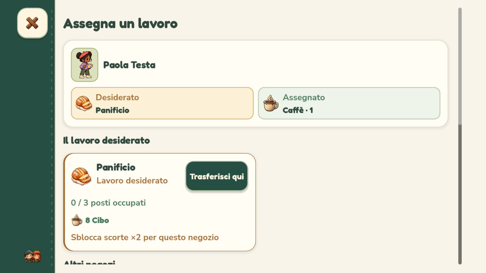
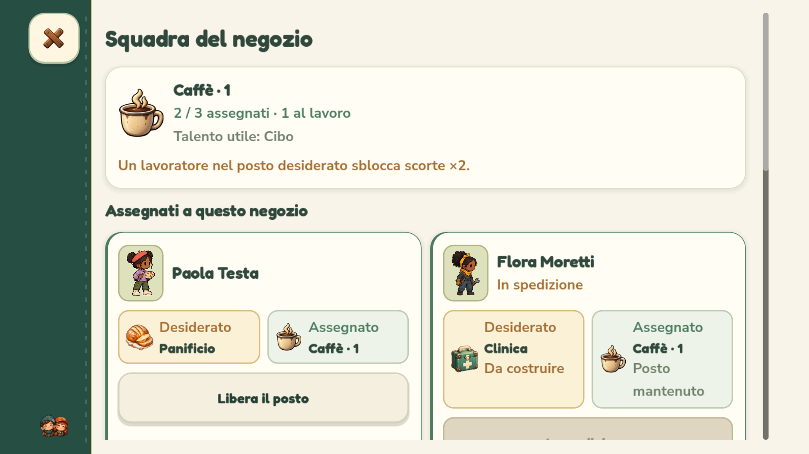

# Lavoro desiderato, incarico e squadra — 0.4.1.46

Le schermate distinguono **Desiderato** e **Assegnato** in due riquadri con nome e icona del negozio. I simboli sono quelli delle insegne in città: caffè, verdure, attrezzi, kit medico, pane, acqua e stoffa. La distinzione compare anche nella lista Cittadini.

## Scegliere il lavoro di una persona

La scheda mostra prima la persona e il confronto fra desiderio e incarico. Il lavoro desiderato viene presentato per primo; gli altri negozi sono separati. Ogni destinazione indica posti occupati, talento utile e bonus, con il comando vicino all'icona:

- **Assegna qui** per una persona libera.
- **Trasferisci qui** se lavora già altrove.
- **Già assegnato**, **Completo**, **In costruzione** o **In spedizione** spiegano i casi non selezionabili.

Dopo una scelta la schermata resta aperta e il riquadro Assegnato mostra il risultato. **Lascia senza incarico** libera il posto senza rimuovere la persona dal rifugio. Se il lavoro desiderato non esiste, il riquadro lo indica come Da costruire. Più negozi dello stesso tipo sono numerati nell'ordine da sinistra a destra.

## Gestire la squadra di un negozio

La schermata mostra l'attività, i posti occupati e le persone effettivamente al lavoro. Separa:

1. **Assegnati a questo negozio**, con comando Libera il posto.
2. **Persone disponibili**, ordinate prima per lavoro desiderato e poi per talento utile.
3. **Trasferisci da un altro negozio**, con origine e destinazione riconoscibili.

Chi è in spedizione conserva il proprio incarico e occupa ancora il posto. Il rientro aggiorna i comandi senza dover richiudere la schermata. Nella bottega si vedono già i ritratti e i nomi della squadra, oltre ai posti liberi. Le due schermate di assegnazione non mostrano valute: cambiare lavoro è gratuito.

Il bonus del desiderio resta quello esistente: raddoppia le scorte una sola volta per edificio e rimane dopo un trasferimento. Non sono modificate regole di assegnazione, capacità, produzione, affinità, costi o salvataggi.

## Verifiche

I test usano profili e salvataggi isolati. Il test dedicato esegue assegnazioni, trasferimenti, liberazione dei posti, negozi completi, spedizioni reali e rientro, cantieri e completamento. Controlla anche che il bonus ×2 non venga perso o duplicato e che il desiderio non si confonda con l'incarico. Copre PC, smartphone 16:9/20:9 e tablet, alle scale compatta e grande.

I profili Android sono simulati su computer: non è stata eseguita una nuova prova su dispositivo fisico.

Sul sorgente passano **1.022 controlli dedicati senza renderer**, **6.309 delle interfacce alle tre scale**, **144 del gameplay cozy**, **90 del tutorial** e **85 delle interazioni smartphone**. Nessun fallimento.

Sul pacchetto Windows esportato passano **1.034 controlli dedicati con OpenGL e 12 acquisizioni**, **6.361 delle interfacce con OpenGL** e **99 delle risorse incorporate**. L'APK supera **57 controlli**, compresa la presenza del nuovo modulo compilato. Nessun fallimento.

Rilascio **0.4.1.46 / Android 401046** completo in `builds/releases/0.4.1.46/`, con setup Windows e APK. SHA-256 dei tre artefatti, metadati, allineamento e firma Android v2/v3 stabile verificati. Eseguibile locale aggiornato, con copia precedente in `.runtime/NienteZombie-prima-lavori.exe`. Log nella cartella `logs/` del rilascio.

Anteprime dal pacchetto Windows con profilo smartphone 16:9:

