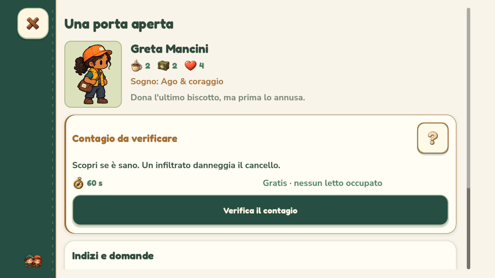
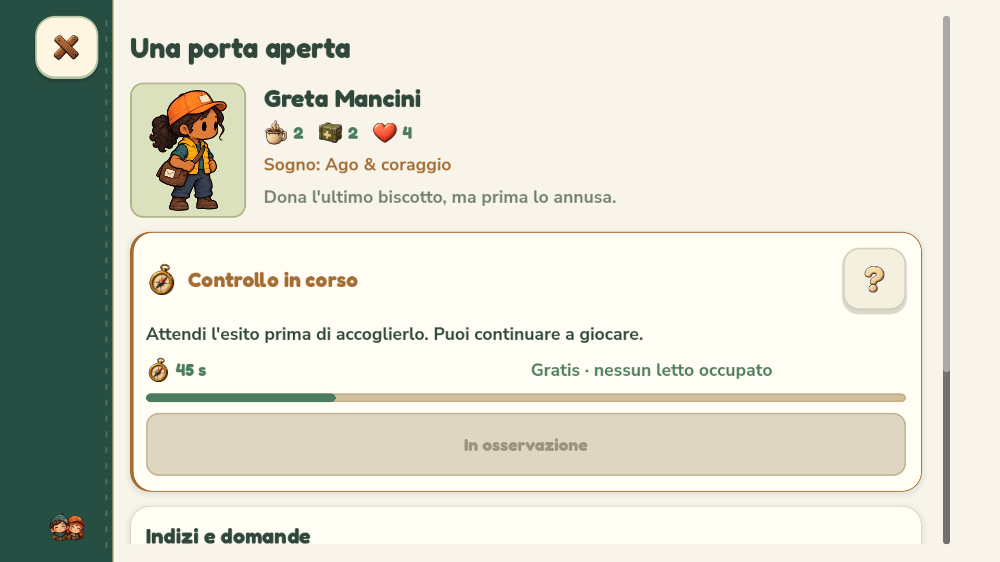

# Capire l'osservazione al cancello — 0.4.1.45

La scheda dei nuovi arrivati spiega direttamente a cosa serve il controllo: **scoprire se una persona è sana prima di accoglierla**. Il pulsante si chiama **Verifica il contagio** e la scheda ricorda che un infiltrato danneggia il cancello.

## Prima, durante e dopo

- **Contagio da verificare:** messaggio breve, durata effettiva e indicazione di gratuità e nessun letto occupato. Il **?** apre una spiegazione aggiuntiva: sporco e graffi possono esserci anche nelle persone sane; il controllo dà un esito certo, per una persona alla volta.
- **Controllo in corso:** conto alla rovescia, barra di avanzamento e invito a continuare a giocare. L'ammissione resta disabilitata con la dicitura **Attendi l'esito**.
- **Nessun contagio rilevato:** stato verde, possibilità di accogliere se ci sono letti; se mancano, la scheda lo spiega.
- **Contagio confermato:** stato rosso, ingresso bloccato e invito ad accompagnare la persona verso l'uscita.

Il completamento viene annunciato anche fuori dalla scheda, con una notifica che distingue persona sana e contagio confermato. La sezione **Indizi e domande** mantiene indizi, domande e risposte; la guida Come si gioca spiega anche il rischio di ammettere un infiltrato senza controllo.

## Regole e salvataggi

Il funzionamento resta facoltativo e gratuito: una persona alla volta, 60 secondi di gioco, 30 dopo aver trovato il Taccuino medico. La durata mostrata usa lo stesso valore del timer effettivo. La durata originale viene conservata per disegnare correttamente l'avanzamento anche se si scopre il Taccuino durante un controllo già iniziato.

Il campo opzionale `observation_duration` ammette solo 30 o 60 secondi ed è salvato insieme al tempo rimasto. I salvataggi precedenti, senza questo campo, restano validi; il formato generale resta versione 2. Nessun cambiamento ai costi, alle probabilità di contagio o alle conseguenze dell'ammissione.

## Verifiche

Profili e file delle prove sono isolati dalla partita del giocatore. Il test dedicato verifica input effettivo su telefoni 16:9/20:9, tablet e PC: nessuna rivelazione anticipata dell'infezione, spiegazione facoltativa, tempi 60/30, avanzamento, gratuità, posto occupato, arrivo al cancello, esiti, ammissione reale, blocco dell'infiltrato e ripresa del salvataggio.

I profili Android sono simulati su computer; non è stata eseguita una nuova prova su dispositivo fisico.

Sul sorgente passano **200 controlli dedicati senza renderer** e **216 con OpenGL e 16 acquisizioni**, **6.309 delle interfacce alle tre scale senza renderer**, **144 del gameplay cozy**, **90 del tutorial** e **372 dello scorrimento**. Nessun fallimento.

Sul pacchetto Windows esportato passano **216 controlli dedicati con OpenGL**, **6.361 delle interfacce con OpenGL e 52 acquisizioni** e **98 delle risorse incorporate**. L'APK supera **56 controlli**, compresa la presenza del modulo compilato `visitor_observation`. Nessun fallimento.

Rilascio **0.4.1.45 / Android 401045** completo in `builds/releases/0.4.1.45/`, con setup Windows e APK. Checksum SHA-256 dei tre artefatti, metadati, allineamento e firma Android v2/v3 stabile verificati. Eseguibile locale aggiornato; copia precedente in `.runtime/NienteZombie-prima-osservazione.exe`. Log nella cartella `logs/` del rilascio.

Anteprime dal pacchetto Windows con profilo smartphone 16:9 e stati simulati:

