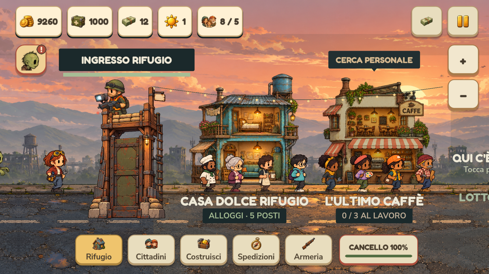
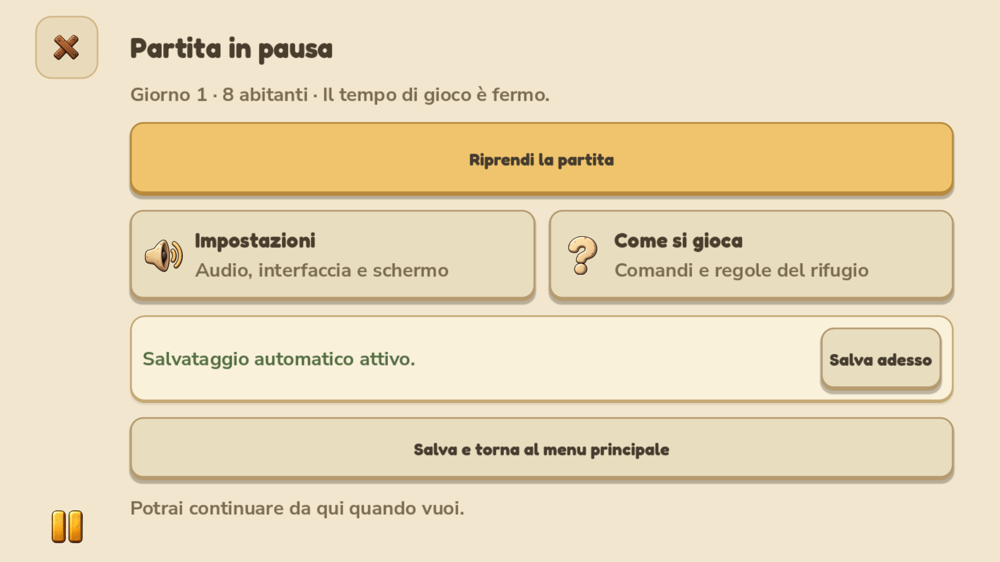

# Vista orizzontale e pausa comprensibile

Il test sul Google Pixel ha chiarito il requisito: sprite grandi e leggibili, una vista iniziale completa in altezza e movimento del mondo esclusivamente orizzontale. La scala della 0.4.1.27 ingrandiva l'intera scena e richiedeva movimento verticale: questo comportamento è stato rimosso.

## Vista iniziale

Gli ingrandimenti delle illustrazioni sono ora separati dallo zoom della telecamera: sui telefoni Android personaggi e zombie usano 2,2, gli edifici 1,6 e la torretta 1,15 rispetto alla base desktop. Distanze tra lotti, posizioni dei lavoratori, aree di selezione, contorni luminosi e origine degli spari seguono le rispettive illustrazioni. Le posizioni nella fila del cancello sono più distanziate per evitare sovrapposizioni fra i personaggi ingranditi; il loro spostamento rimane animato.

La vista iniziale e il limite minimo dello zoom si adattano all'altezza disponibile: devono entrare edifici, torretta intera, militare, cartelli superiori e contatori del lavoro. Il controllo viene ripetuto dopo cambio delle dimensioni dell'interfaccia e dei margini sicuri. Lo zoom aggiuntivo, fino a 1,8 volte la vista completa, è richiesto dal giocatore attraverso pinch o pulsanti. Rifugio e Cancello tornano alla vista completa.

La strada ha una quota fissa. Lo stato e i comandi della telecamera verticale sono eliminati: uno swipe verticale non muove la scena né attiva un edificio. La navigazione resta orizzontale anche dopo aver aumentato lo zoom. PC e tablet conservano la presentazione precedente.

## Pausa

La pagina mostra esplicitamente **Partita in pausa**, giorno, abitanti e il fatto che il tempo di gioco sia fermo. La gerarchia delle azioni è:

1. **Riprendi la partita**, azione principale.
2. **Impostazioni** e **Come si gioca**, con una breve descrizione di ciò che aprono.
3. **Salva adesso**, vicino allo stato del salvataggio automatico. Il risultato della scrittura viene mostrato nella pagina; un errore non viene presentato come successo.
4. **Salva e torna al menu principale**, separato dalle opzioni, con conferma testuale che sarà possibile continuare.

Impostazioni e guida aperte dalla pausa hanno un comando Indietro che torna alla pausa, mantenendo fermo il gioco. Anche il tasto Back/Esc segue questa logica. Riprendi è esplicito: riavvia il tempo di gioco anche se la pausa era stata attivata in precedenza. I crediti rimangono disponibili dal menu principale.

## Verifiche del sorgente

| Verifica | Controlli | Errori |
| --- | ---: | ---: |
| Layout e ingombro reale della vista completa, renderer OpenGL | 2.129 | 0 |
| Interazioni telefono: pausa, salvataggio, acquisti, lavoro, spedizioni e gesti | 73 | 0 |
| Scorrimento dei dialoghi e isolamento dal mondo | 264 | 0 |
| Flussi precedenti desktop/tablet | 830 | 0 |
| Simulazione, salvataggi e sessione prolungata | 751 | 0 |
| Camminata, fermata e pausa delle animazioni | 52 | 0 |
| Momento degli avvisi e arrivo al cancello | 40 | 0 |

I test coprono telefoni 16:9 e 20:9, Compatta/Media/Grande e notch su entrambi i lati. La verifica della vista completa confronta la geometria effettiva con lo spazio fra HUD superiore e navigazione inferiore: edifici, torretta, militare, fumetti e contatori devono entrarvi interamente alla vista minima. Sono verificati anche avvio della partita, zoom volontario e assenza di movimento verticale con touch emulato.

Anteprime e test sono eseguiti sul computer; non è dichiarato un nuovo collaudo su un Pixel fisico. I log sono in `.runtime/horizontal-*.log`. Il renderer segnala la cache shader non scrivibile nel profilo di prova, ma rendering e verifiche terminano correttamente. Backup dei sorgenti della 0.4.1.27 in `.runtime/horizontal-before-0.4.1.28/`.

## Rilascio

Generati **0.4.1.28 / Android 401028** con il BAT, con APK firmato, setup Windows ed eseguibile autonomo nella relativa cartella `builds/releases/`. Firma Android v2/v3 valida e invariata, allineamento e metadati corretti. Checksum dei tre artefatti ricalcolati e coincidenti con il manifest.

Sul codice incorporato nel pacchetto Windows, da una cartella senza sorgenti, sono passati nuovamente **2.129 controlli layout** e **830 controlli UX**. Le **73 interazioni** sono passate anche sul pacchetto con renderer OpenGL e input touch emulato, inclusi ritorno alla pausa, salvataggio, navigazione orizzontale e pinch. Superati inoltre **87 controlli delle risorse Windows** e **36 controlli dell'APK**.

La copia Windows dei collegamenti è aggiornata; la 0.4.1.27 è conservata in `.runtime/NienteZombie-prima-zoom-orizzontale.exe`. I log sono conservati nel rilascio. Le verifiche del pacchetto non sostituiscono il test sul dispositivo fisico.
