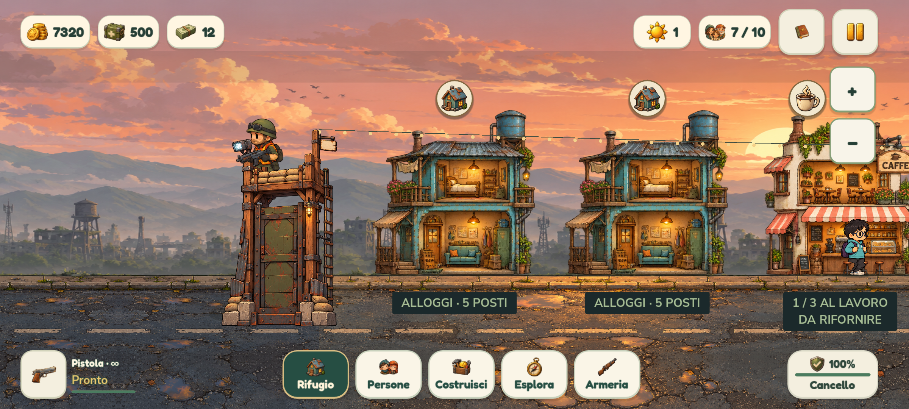
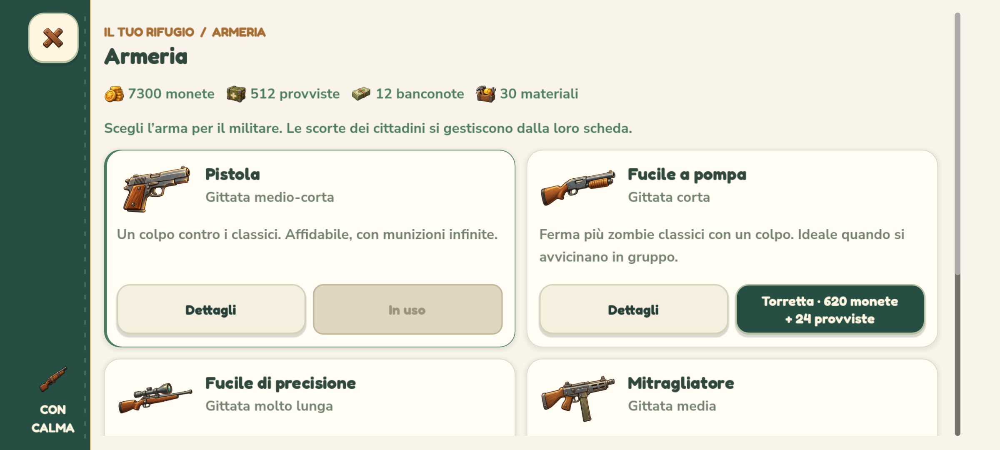
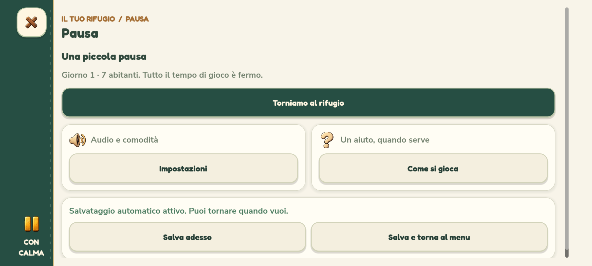

# Scorrimento touch e nuova interfaccia — 0.4.1.41

## Correzione del gesto

Il mondo ora usa direttamente `InputEventScreenTouch` e `InputEventScreenDrag` per il trascinamento con un dito. Prima il percorso a un dito dipendeva dal mouse emulato e l'area attiva era limitata da due margini verticali fissi. Il percorso touch precedente trattava direttamente soprattutto il pinch.

`world_touch.gd` mantiene il gesto dal primo contatto al rilascio, anche quando il dito attraversa insegne, edifici o HUD. Usa lo spostamento assoluto del dito, quindi sopporta anche eventi di movimento poco frequenti. La telecamera segue subito il dito; al rilascio conserva una breve inerzia orizzontale con decadimento e limiti del villaggio. Un nuovo contatto, un menu, zoom/comandi di navigazione, ridimensionamento, sospensione o perdita di focus interrompono l'inerzia o il gesto pertinente. Non esiste trascinamento verticale della scena.

Il tocco breve apre la scheda corretta; la pressione immobile di 0,65 secondi mantiene la demolizione con conferma. Superata la soglia di otto unità del viewport, il trascinamento annulla la pressione prolungata e non genera un clic al rilascio. Due dita attivano il pinch dal primo spostamento e il rilascio non diventa un tocco. Gli eventi del mouse emulato non duplicano i gesti touch mobili. Il percorso del mouse fisico rimane disponibile su PC.

Il controllo delle aree interattive usa i rettangoli effettivi dell'interfaccia, con la relativa trasformazione e scala. Comprende anche tutorial e avviso zombie, che non sono figli del solo contenitore HUD. Un gesto iniziato su un pulsante appartiene all'interfaccia; un gesto iniziato nel mondo continua a essere del mondo anche attraversando quel pulsante.

Con il mitragliatore, una pressione ferma avvia la raffica dopo 0,12 secondi. Il trascinamento la interrompe e permette di scorrere anche partendo da uno zombie. Un tocco rapido spara al rilascio. Nessuno sparo automatico viene aggiunto alla guardia.

## Nuovo HUD per smartphone

- Risorse in pillole separate in alto a sinistra, giorno e abitanti verso destra, diario illustrato e pausa all'estremità.
- Navigazione centrale in basso: Rifugio, Persone, Costruisci, Esplora e Armeria. Pulsanti separati e selezione verde con cornice miele.
- Arma, colpi e recupero in basso a sinistra; stato e accesso al cancello a destra. Sui formati più stretti la descrizione dell'arma si comprime lasciando il pulsante illustrato.
- Le grandi scorciatoie contestuali superiori cedono il posto a piccoli indicatori sulle voci di navigazione per merce pronta, persone al cancello e spedizioni. Il villaggio resta più libero.
- Le aree di tocco restano ampie e separate, indipendentemente dalle animazioni delle icone. Margini, notch e tre dimensioni dell'interfaccia restano supportati.

`mobile_hud.gd` compone l'HUD dei telefoni Android; PC e tablet conservano la propria disposizione con il nuovo stile comune. Il mondo, le dimensioni degli sprite e i limiti orizzontali restano quelli della revisione cozy.

## Stile e animazioni

Nuova palette con verde profondo, carta chiara, salvia e miele. Pulsanti principali verdi con testo crema, superfici secondarie chiare, schede arrotondate con ombre soffici e accenti laterali. Il sistema condiviso si applica a costruzioni, botteghe, cittadini, equipaggiamento, spedizioni, diario, accoglienza, difese, pausa, impostazioni, aiuto, crediti e conferme.

Sui telefoni una fascia laterale verde con bordo cucito raccoglie chiusura, aiuto contestuale e icona della sezione. Titolo, saldi, contenuti e azioni scorrono insieme nella pagina a tutto schermo; i margini restano simmetrici e non vengono aggiunte app bar o azioni fisse che sottraggano altezza.

Le pagine compaiono con dissolvenza e una breve successione dei contenuti. La selezione della navigazione anima l'icona, i pulsanti hanno un riscontro luminoso morbido e la chiusura dissolve la vecchia vista in 0,12 secondi. La vista in uscita smette subito di intercettare l'input e viene poi liberata; la chiusura logica e il ripristino del gioco restano immediati. I rifornimenti e gli acquisti nella stessa scheda mantengono lo scorrimento e non riavviano l'ingresso.

**Impostazioni → Riduci le animazioni** disattiva le nuove transizioni, il riscontro animato dei pulsanti, il movimento di selezione e l'inerzia al rilascio. La preferenza è persistente e separata dal salvataggio della partita. Lo scuotimento della visuale conserva il proprio comando separato. Non ci sono animazioni decorative in ciclo continuo nel nuovo HUD.

## Asset del diario

Nuova icona generata con lo strumento integrato imagegen, per distinguere visivamente il diario dalle banconote. File originale con trasparenza preservata: `assets/art/journal.png`. Viene ritagliata in memoria alla sagoma e dotata di mipmap isolate una sola volta, tramite la cache delle icone HUD, come le altre icone dipinte. Appare nel pulsante del diario e nella relativa pagina.

Prompt integrale:

> Use case: stylized-concept. Asset type: a single standalone painted icon for the HUD and menu of a cozy cartoon post-apocalyptic village game. Primary request: a charming chunky closed refuge diary notebook, slight three-quarter view from front above. Warm worn cognac leather cover with rounded corners, cream paper edges, sage green fabric spine, one small golden sun medallion embossed in the middle, a short ochre ribbon bookmark, tiny stitched seam. Friendly toy-like proportions and clean readable silhouette. Hand painted storybook game art with dark soft brown outlines, gentle warm highlights, restrained texture, consistent with illustrated coffee cups, bread and little village houses. Single isolated object, centered, fully visible, generous 15 percent transparent padding on every side. True transparent background. No background, no ground, no shadow outside the object, no loose papers or extra objects, no letters, words, numbers or logos, no watermark. Must remain immediately recognizable as a book at 28 pixels.

## Verifiche

I test usano profili e partite isolati. I profili Android sono simulati sul computer con il renderer nativo OpenGL e input effettivo, non costituiscono una nuova prova su Pixel fisico. Il salvataggio del rifugio resta compatibile con la versione 2; il bilanciamento cozy non è modificato.

| Verifica del sorgente | Controlli | Fallimenti |
| --- | ---: | ---: |
| Touch diretto, superfici, inerzia, pinch, mouse emulato, mitragliatore, cancellazioni e focus — anche con OpenGL | 135 per esecuzione | 0 |
| Interfacce, quattro profili, tre scale UI, input effettivo, margini e separazione HUD, con OpenGL | 3.757 | 0 |
| Animazioni, transazioni durante l'ingresso, chiusura e preferenza persistente | 65 | 0 |
| Demolizione con mouse e touch, senza acquisizioni | 228 | 0 |
| Scorrimento verticale dei dialoghi | 372 | 0 |
| Interazioni smartphone | 85 | 0 |
| Tiro, raffica e rilascio | 25 | 0 |
| Tutorial completo | 90 | 0 |
| Gameplay cozy e persistenza | 144 | 0 |

Il test precedente della demolizione ora invia il movimento touch diretto oltre a quello del mouse emulato. Il test delle transazioni animate usa il pulsante munizioni attuale. Restano verificati tutti i comportamenti precedenti, compresa la cancellazione della pressione prolungata quando si mescolano mouse fisico e touch.

Sul pacchetto Windows esportato passano **135 controlli dei gesti con OpenGL**, **3.757 delle interfacce con OpenGL** e **94 delle risorse**, compresa la nuova icona con mipmap. L'APK supera **52 controlli**, con i tre nuovi moduli e la texture del diario. Nessun fallimento. I test del pacchetto partono dalla cartella del rilascio e usano le risorse incorporate.

Rilascio **0.4.1.41 / Android 401041** completo in `builds/releases/0.4.1.41/`. Setup Windows, eseguibile e APK verificati con SHA-256; metadati, allineamento e firma Android v2/v3 corretti, con lo stesso certificato delle versioni precedenti. Eseguibile dei collegamenti aggiornato; copia precedente in `.runtime/NienteZombie-prima-mobile-polish.exe`. Log del sorgente e dei pacchetti nel rilascio.

Anteprime dal pacchetto Windows, con profilo smartphone 20:9:

