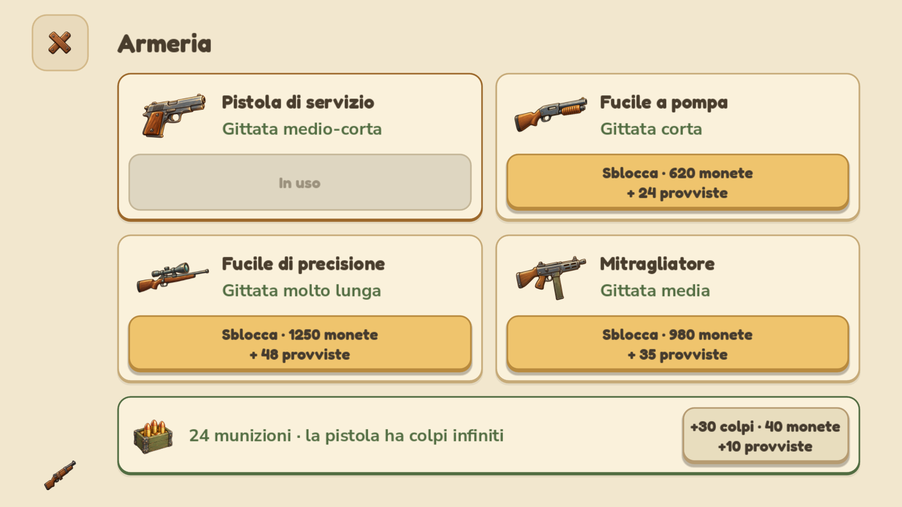
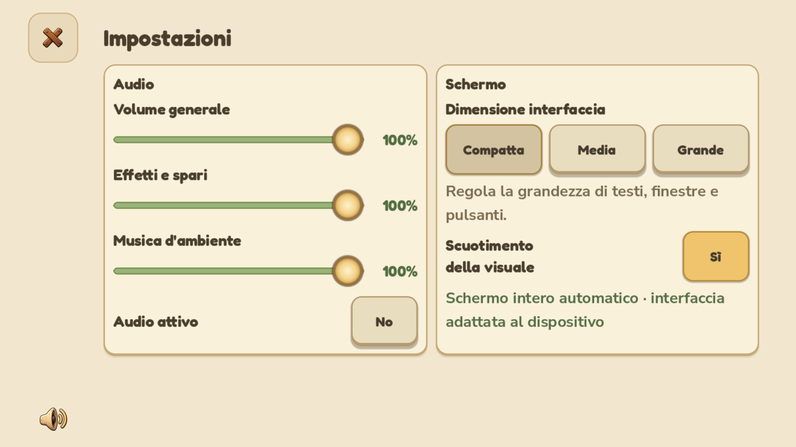
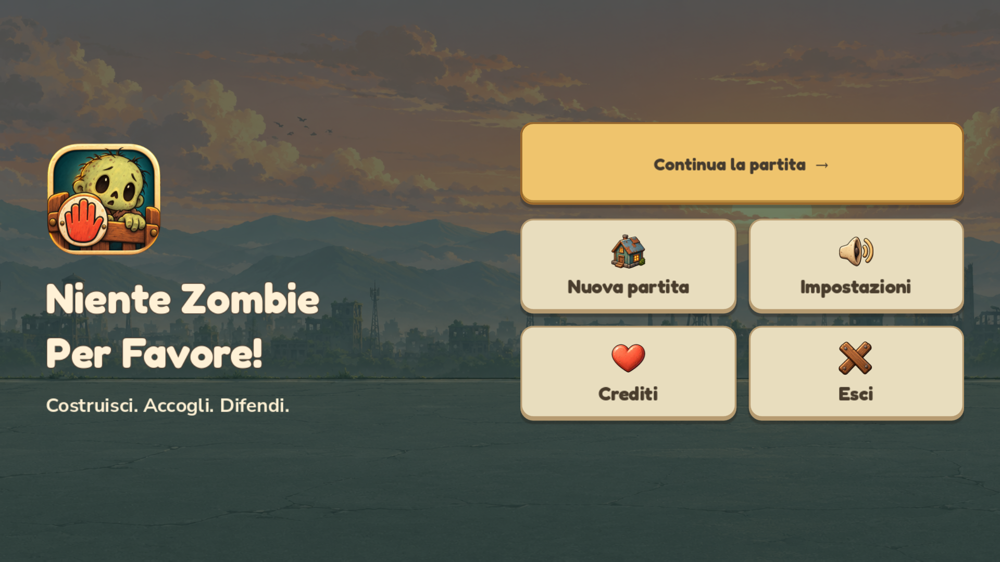

# Smartphone: mondo raddoppiato e nuove pagine

Documento storico della 0.4.1.27. La telecamera è stata corretta nella [0.4.1.28](SMARTPHONE_HORIZONTAL_0.4.1.28.md): sprite e zoom separati, vista iniziale completa e scorrimento esclusivamente orizzontale. Anche la pausa ha una nuova gerarchia di azioni.

Questa revisione segue il feedback sulla 0.4.1.26: elementi ancora piccoli sul telefono, dialoghi affollati e spazio eccessivo occupato dalle fasce fisse. Le modifiche di presentazione sono riservate agli smartphone Android sotto 600 dp; PC e tablet mantengono la loro composizione.

## Dimensioni del mondo

La scala passa da 1,80 a **3,60**, raddoppiando personaggi, zombie ed edifici rispetto alla build precedente a parità di zoom. Il massimo diventa **4,50**; il minimo **2,16**. Le scritte del mondo raddoppiano anch'esse: nomi degli edifici, indicatori di lavoro, fumetti e cartelli. Gli sfondi delle etichette vengono dimensionati sul nuovo testo, senza ritagliarlo.

Gli edifici più alti possono superare lo schermo. Il trascinamento del telefono ora sposta la visuale anche verticalmente, con limiti e interpolazione; si possono esplorare i piani superiori e tornare sulla strada. Le scorciatoie Rifugio e Cancello ripristinano la visuale a livello del suolo. Il pinch annulla il trascinamento singolo, evitando gesti sovrapposti. Aree di selezione e posizione degli spari seguono la stessa trasformazione delle illustrazioni.

## Dialoghi

Tutte le tipologie usano una pagina a schermo intero con fondo color carta. Una colonna laterale stretta contiene la chiusura e, negli edifici, il punto interrogativo. Titolo, contenuto e azioni condividono lo stesso scorrimento: non ci sono app bar o footer fissi a sottrarre altezza.

Il margine esterno rispetta i quattro lati dell'area sicura. Dentro lo scorrimento un contenitore dedicato mantiene **24 unità logiche sia a sinistra sia a destra**, indipendentemente dalla barra di scorrimento. I testi lunghi vanno a capo e le righe che non entrano si dispongono in verticale. Il corpo usa almeno 22 unità, i pulsanti 20, il titolo 32. Le aree touch restano di almeno 72 unità per i pulsanti. La chiusura è sempre raggiungibile senza occupare una fascia superiore.

- **Armeria:** quattro schede in due colonne quando lo spazio lo consente, con illustrazione apribile per i dettagli e un'azione esplicita per arma. Le munizioni sono una sezione della pagina, non un footer. Nel formato Compatto collaudato entrano insieme armi e munizioni.
- **Spedizioni:** destinazioni in schede; la scelta conduce direttamente alla squadra. Le selezioni restano memorizzate e i controlli di partenza scorrono con la lista.
- **Edifici:** apertura centrata su lavoratori e prodotti. Le istruzioni estese sono nel punto interrogativo; i prodotti bloccati hanno una riga sintetica con il numero di lavoratori necessari.
- **Impostazioni:** Audio e Schermo affiancati nei formati provati, cursori sotto le rispettive etichette e chiusura laterale. Il cambio Compatta/Media/Grande viene verificato sulla pagina già aperta.
- **Cittadini e assegnazioni:** ritratto, identità e talenti leggibili, con azioni e testo disposti nella pagina. Equipaggiamento e cura conservano gli stessi dati del cittadino.
- **Menu iniziale:** logo e titolo a sinistra, azione Gioca/Continua evidente e griglia di azioni illustrate a destra. Il menu di pausa mette Riprendi vicino al riepilogo e non riserva un footer.

## Verifiche

Le anteprime sono prodotte con il renderer OpenGL del computer, non su hardware Android. Sono collaudati telefoni 16:9 e 20:9, tre dimensioni dell'interfaccia e notch simulato su entrambi i lati. I riferimenti desktop e tablet vengono confrontati nello stesso test.

- `test_android_phone.gd`: **2.077 controlli, 0 errori**, con renderer e catture. Copre 22 pagine/stati, inclusi assegnazione, scelta lavoro, spedizione in corso e rientrata, oltre alle dimensioni effettive del mondo e ai tocchi sui bersagli.
- `test_phone_interactions.gd`: **57 controlli, 0 errori**. Taps e gesti attraversano il viewport: menu, cambio dimensioni dal vivo, acquisto arma/munizioni, dettagli, scelta destinazione, squadra e partenza, aiuto edificio, assegnazione e rifornimento, trascinamento verticale, pinch e sparo successivo.
- `test_touch_scroll.gd`: **264 controlli, 0 errori** sul profilo telefono. Le pagine interamente visibili sono verificate senza richiedere scroll inutile; gli swipe non acquistano, non selezionano e non muovono il mondo né orizzontalmente né verticalmente.
- `test_ux_flow.gd`: **830 controlli, 0 errori** per le presentazioni precedenti PC/tablet.
- `test_arrival_feedback.gd`: **40 controlli, 0 errori**, conservando il momento corretto degli avvisi.

I log temporanei sono in `.runtime/phone-pages-*.log`. Le nuove prove isolano salvataggi e preferenze in `.runtime/`. Il renderer segnala la cache shader non scrivibile nel profilo di prova; rendering e test terminano correttamente. Backup dei sorgenti precedenti in `.runtime/phone-pages-before-0.4.1.27/`.

## Rilascio verificato

Generati **0.4.1.27 / Android 401027** con il BAT: APK firmato, setup Windows ed eseguibile autonomo in `builds/releases/0.4.1.27/`. Firma Android v2/v3 e allineamento verificati; stesso certificato dei rilasci precedenti. Checksum dei tre artefatti ricalcolati e coincidenti con il manifest.

Sul codice incorporato nel pacchetto, da una cartella senza sorgenti, sono passati nuovamente **2.077 controlli del layout** e **830 controlli dei flussi precedenti**. Il test delle **57 interazioni** è passato sul pacchetto con renderer OpenGL e coppie di eventi touch/mouse emulato, inclusi produzione e pinch. Superati **87 controlli delle risorse Windows** e **36 controlli dell'APK**, con verifica del nuovo controller compilato `phone_pages.gdc`.

Log conservati nel rilascio. La copia Windows usata dai collegamenti è aggiornata e verificata; la 0.4.1.26 è conservata in `.runtime/NienteZombie-prima-pagine-smartphone.exe`. Non è dichiarato un test su telefono fisico.
